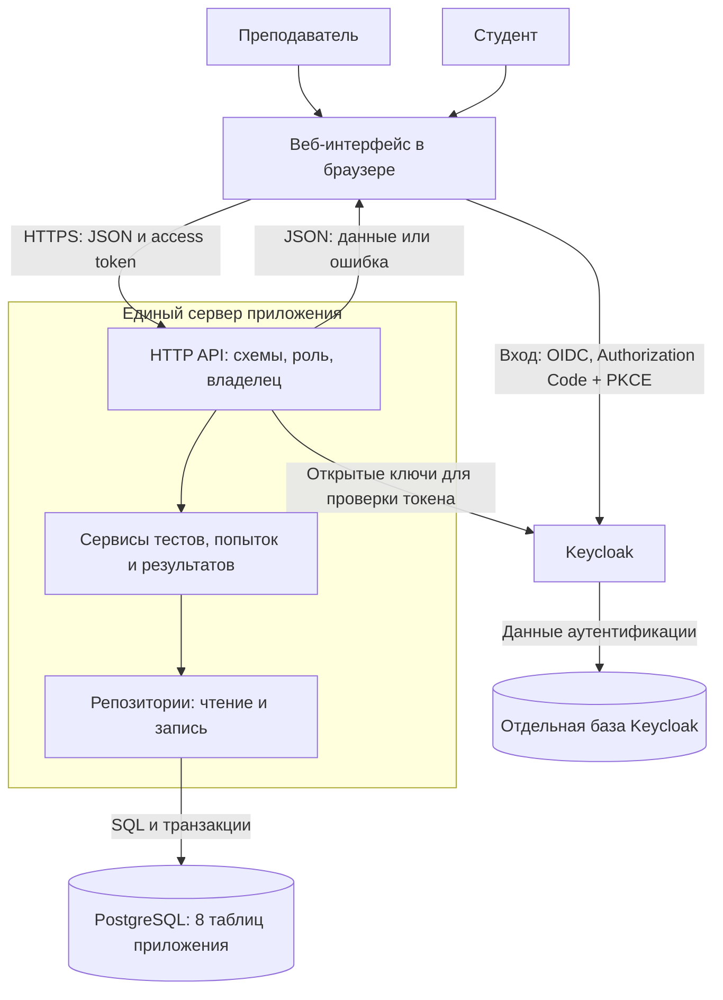

# Архитектура веб-приложения Delul

## Проект в одном предложении

Delul — веб-приложение для преподавателей университета, которые создают тесты и просматривают результаты, и студентов, которые проходят тесты и разбирают ошибки.

Основание: обязательные истории US-1–US-4 из [user-stories.md](user-stories.md), модель из [er-diagram.md](er-diagram.md) и проект контракта [api.md](api.md). Это предложение архитектуры, а не описание уже работающего приложения.

## Предлагаемые части

| Часть | Назначение | С кем взаимодействует |
|-------|------------|------------------------|
| Веб-интерфейс | Страницы преподавателя и студента: создание теста, прохождение, работы, разбор ошибок. Один интерфейс с отображением доступных действий по роли. | Сервер приложения и Keycloak. |
| Keycloak | Вход и управление учётными данными. | Браузер проходит вход; сервер проверяет подписанный access token по опубликованным ключам. |
| Сервер приложения | Один развёртываемый процесс с модулями тестов, попыток и результатов. Проверяет данные, роль и принадлежность ресурса. | Веб-интерфейс, PostgreSQL, открытые ключи Keycloak. |
| PostgreSQL приложения | Хранит восемь таблиц ER-модели: профили, категории, тесты, вопросы, варианты, попытки, ответы и результаты. | Только сервер приложения. |
| Хранилище Keycloak | Хранит данные аутентификации отдельно от таблиц приложения. Может использовать тот же сервер PostgreSQL, но отдельную базу и учётную запись. | Только Keycloak. |

Файлы интерфейса и запросы `/api/` желательно отдавать с одного домена. Это не требует отдельного API Gateway. Приложение развёртывается одним сервером; Keycloak — отдельный сервис аутентификации.

## Mermaid flowchart

Стрелка к Keycloak за ключами не означает сетевой вызов при каждом API-запросе: сервер может сохранять открытые ключи в памяти и обновлять их при смене ключа. Подпись, издатель, аудитория и срок токена проверяются сервером.

## Как части работают вместе

1. Пользователь проходит вход через Keycloak. Браузер получает токены через стандартный поток OIDC с PKCE; клиентский секрет в интерфейс не помещается.
2. Интерфейс передаёт access token серверу в заголовке Authorization. Сервер определяет пользователя и роль, проверяет право на конкретный тест или попытку. Скрытая кнопка в интерфейсе не заменяет серверную проверку.
3. **US-1:** преподаватель создаёт черновик с вопросами и вариантами. Сервис проверяет публикацию, репозиторий сохраняет данные в PostgreSQL.
4. **US-2:** студент начинает попытку и отправляет ответы. Сервер проверяет владельца попытки, состояние теста и соответствие вопросов и вариантов.
5. **US-3:** тот же сервер синхронно рассчитывает баллы и атомарно сохраняет ответы, завершение попытки и результат. Отдельный сервис проверки и очередь для текущих вопросов с одним правильным вариантом не требуются.
6. **US-4:** преподаватель открывает результаты. Сервер разрешает студенту получить только собственные баллы, ответы, правильные варианты и пояснения. До открытия эти сведения не выдаются в API студенту.

## Внутренние слои сервера

- **Маршрутизаторы и схемы:** разбор HTTP и проверка структуры запросов; преобразование ошибок в HTTP-ответы.
- **Сервисы:** сценарии приложения, права на действия, переходы состояний, расчёт результата и границы транзакций.
- **Репозитории и модели:** SQL, связи и ограничения PostgreSQL.
- **Общие настройки:** подключение к базе, параметры Keycloak и журналирование. Секреты задаются окружением сервера.

Эти слои — части одного приложения. Разделение по каталогам не означает отдельные сетевые сервисы.

## Проверка по пяти признакам

В задании сами пять признаков не перечислены. Для этой проверки приняты: (1) связь с Must-историями, (2) соответствие известному масштабу, (3) сложность разработки и сопровождения, (4) необходимость в данных и безопасности, (5) наличие более простого способа. Данных о высокой нагрузке пока нет.

### Дополнительные варианты, предложенные для критики

**Вариант А:** выделить тесты, попытки и проверку в отдельные микросервисы с API Gateway и очередью сообщений.

**Вариант Б:** добавить Redis для кэширования списков тестов и результатов.

Оба варианта рассмотрены как возможные расширения, но по оценке ниже исключены из предлагаемого MVP. Они не включены в итоговую схему.

| Предложение | Какие признаки показывают избыточность | Почему не принято в MVP | Что используем вместо |
|-------------|---------------------------------------|-------------------------|-----------------------|
| Микросервисы, API Gateway и очередь | Не требуются US-1–US-4; высокая нагрузка не подтверждена; усложняют развёртывание и атомарное сохранение ответов и баллов; есть простая альтернатива. | Для короткой синхронной проверки нет подтверждённой необходимости в распределённой обработке. | Один сервер с внутренними модулями и транзакцией PostgreSQL. |
| Redis для списков и результатов | Нет измерений задержек; не добавляет обязательной функции; требует настройки и сброса кэша при изменениях, особенно при открытии результатов. | Усложняет согласованность и доступ к закрытым результатам без доказанной пользы. | Чтение из PostgreSQL с ограничением размера списков и индексами по ключам запросов. |

## Итог после критики

В MVP остаются один веб-интерфейс, один сервер приложения, PostgreSQL и уже согласованный Keycloak со своим хранилищем. Микросервисы, отдельный шлюз, очередь и Redis не приняты в эту версию.

До реализации нужно согласовать привязку профиля к субъекту Keycloak, источник ролей и исправления маршрутов из проверки API. Эти вопросы не требуют новых сервисов. Имена и группа пока читаются из текущего профиля согласно существующей модели.
