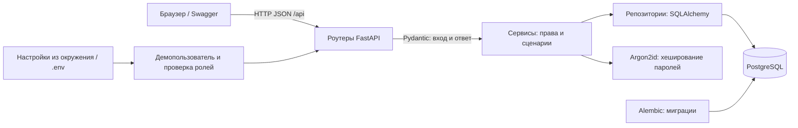

# Архитектура Delul

Учебный backend для преподавателей и администраторов, создающих тесты, и студентов, которые сдают их и получают баллы.

| Компонент | Назначение |
|-----------|------------|
| Браузер / Swagger | Запросы к API; Swagger доступен в /api/docs |
| Роутеры и схемы | HTTP, валидация структуры, коды ответов; SQL в роутерах нет |
| Сервисы | Права, авторство, состояния, публикация, сдача и расчёт результата |
| Репозитории | Чтение и изменение через SQLAlchemy; health выполняет SELECT 1 |
| PostgreSQL | Восемь таблиц из er-diagram.md; FK, UNIQUE, CHECK и транзакции |
| Настройки и зависимости | DATABASE_URL и DEMO_USER_EMAIL; пользователь определяется сервером по БД; разрешённые роли проверяются зависимостью |
| Argon2id | Уникальная соль; новые хеши начинаются с $argon2id$; старые PBKDF2-хеши обновляются после успешного login; хеши не попадают в ответы |
| Alembic | Начальная миграция схемы; запускается отдельно от сервера |

Login только проверяет пароль, не создаёт токен или сессию и не меняет демопользователя. Защищённые эндпоинты работают в ENVIRONMENT=local с DEMO_USER_EMAIL. Это учебный режим; полноценная аутентификация не реализована.

Создание теста с вопросами, замена набора вопросов и сдача с сохранением ответов и результата выполняются атомарно. Изменение и сдача блокируют строку теста в PostgreSQL. После публикации содержание не меняется. При конфликте связанные данные сохраняются, удаление истории ограничено.

Frontend Next.js и Keycloak из прежнего проекта не реализованы и в текущем API не используются. Новый контракт регистрации и проверки пароля заменил план Keycloak. AI, Redis, очередь и микросервисы не добавлены: для текущих операций достаточно одного backend и PostgreSQL.

Ошибки сервисов определены в services/errors.py и не содержат HTTP-кодов. Обработчик main.py переводит их в 400/401/403/404/409/422/503. Транзакция управляется unit_of_work репозитория, а конфликты целостности преобразуются в доменную ошибку. В репозиториях нет правил авторства и ролей.
