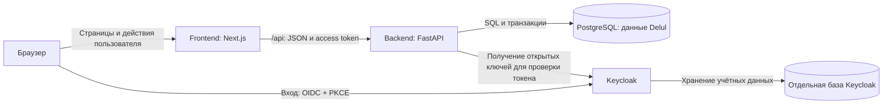

# Архитектура (урок 6)

Delul — веб-приложение для преподавателей университета, которые создают тесты и просматривают результаты, и студентов, которые проходят тесты и разбирают ошибки.

## Схема

Стек Next.js + FastAPI выбран для предлагаемой архитектуры по шаблону занятия; этот документ не означает, что приложение уже реализовано. `/api` — публичный путь запросов интерфейса к backend. Запросы могут проходить через прокси того же домена; отдельный API Gateway не требуется.

Вход выполняется в браузере через Keycloak. Интерфейс передаёт access token серверу. FastAPI проверяет подпись, издателя, аудиторию, срок токена, роль и принадлежность ресурса. Открытые ключи можно сохранять в памяти сервера: сетевой вызов к Keycloak при каждом запросе не требуется.

## Компоненты

| Компонент | Что делает | Урок |
|-----------|------------|------|
| Браузер | Показывает интерфейс преподавателя или студента; выполняет вход через Keycloak и действия пользователя. | — |
| Frontend: Next.js | Страницы создания теста, прохождения, просмотра работ и разбора ошибок; отправка запросов к `/api`. | — |
| Backend: FastAPI | Проверяет вход, права и данные; создаёт и публикует тесты, сохраняет ответы, рассчитывает баллы, открывает результаты. | 7–9 |
| PostgreSQL: данные Delul | Хранит восемь таблиц из ER-модели; обеспечивает связи, ограничения и транзакции. | — |
| Keycloak | Выполняет вход и выдаёт токены; предоставляет открытые ключи для их проверки. | — |
| Отдельная база Keycloak | Хранит данные аутентификации отдельно от таблиц Delul; доступна только Keycloak. | — |

Номера 7–9 для backend взяты из шаблона. Для остальных компонентов номера уроков в предоставленном материале не указаны, поэтому оставлены «—». Базы приложения и Keycloak могут размещаться на одном сервере PostgreSQL, но используют разные базы и учётные записи.

## Что происходит внутри backend

Backend остаётся одним приложением с внутренними слоями:

- Маршрутизаторы и схемы — HTTP-запросы, проверка структуры данных и коды ответов.
- Сервисы — сценарии тестирования, проверки прав, статусы и расчёт баллов.
- Репозитории и модели — SQL, чтение и запись в PostgreSQL.
- Общие настройки — подключение к базе, параметры Keycloak и журналирование; секреты задаются окружением сервера.

При отправке попытки ответы, статус попытки и результат сохраняются одной транзакцией. За правильный ответ начисляется 1 балл, за ошибку или пропуск — 0. После отправки ответы не изменяются.

## Связь с Must-историями

| История | Как выполняется |
|---------|-----------------|
| US-1 | Преподаватель создаёт тест в интерфейсе → FastAPI проверяет и сохраняет вопросы и варианты в PostgreSQL → публикует тест. |
| US-2 | Студент проходит опубликованный тест → FastAPI проверяет владельца и сохраняет ответы с привязкой к профилю. |
| US-3 | FastAPI рассчитывает баллы при отправке → преподаватель получает работы и результаты через API. |
| US-4 | Преподаватель открывает результаты → студент получает только свой результат, правильные варианты и пояснения. |

Скрытие кнопок в интерфейсе не заменяет проверку прав на backend. Правильные ответы и пояснения не выдаются студенту до открытия результатов. Пароли и токены не хранятся в таблице `users`.

## Что исключено из схемы

- **Ollama и стрелка AI:** в US-1–US-4 нет генерации вопросов или другого обязательного AI-сценария. Проверка вариантов выполняется обычным сравнением, а пояснение заранее задаёт преподаватель. Вместо шаблонного текста «AI-запрос» стрелка исключена полностью.
- **Микросервисы, отдельный API Gateway и очередь:** не нужны для текущего синхронного сценария; вместо них один backend и транзакция PostgreSQL.
- **Redis:** нет измеренной проблемы скорости; дополнительный кэш усложнил бы обновление и разграничение доступа к результатам.

Причины отказа от двух дополнительных предложений записаны в [prompt-log.md](prompt-log.md). Они являются оценкой агента и не выданы за личное решение автора проекта.

## Проверка по заданию

- Первая строка описывает конкретный проект: для кого он и что делает.
- Схема использует Mermaid `flowchart LR`.
- Все шесть компонентов схемы перечислены в таблице, лишних сервисов нет.
- Стрелка AI и Ollama исключены по Must-историям.
- Модель данных и API описаны в [er-diagram.md](er-diagram.md) и [api.md](api.md); таблицы и эндпоинты этим документом не изменяются.
- До реализации нужно согласовать привязку профиля к субъекту Keycloak и источник ролей; замечания предыдущей проверки API остаются отдельным списком.
