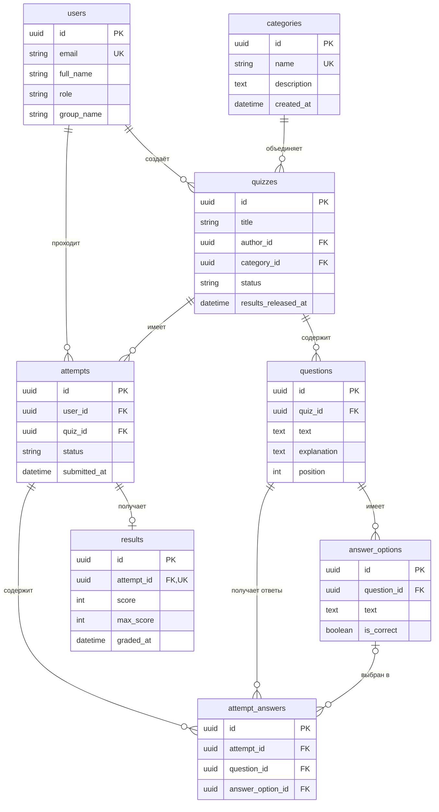

# Модель данных (урок 6)

Модель для университетского тестирования. Названия таблиц и полей — на английском, пояснения — на русском. PK — первичный ключ, FK — внешний ключ, UK — уникальное значение. Во всех таблицах `id` имеет тип UUID.

## Таблицы

- `users`: `id`, `email`, `full_name`, `role`, `group_name`. Пользователи: уникальный обязательный email, полное имя и роль `teacher` или `student`. `group_name` — учебная группа студента, обязательна для роли `student`; для преподавателя может быть NULL. Паролей и других секретов в этой таблице нет.
- `categories`: `id`, `name`, `description`, `created_at`. Категории тестов: уникальное название, описание и дата создания.
- `quizzes`: `id`, `title`, `author_id`, `category_id`, `status`, `results_released_at`. Тест: название, автор-преподаватель, категория, статус `draft`, `published` или `closed`, время открытия результатов (до открытия — NULL).
- `questions`: `id`, `quiz_id`, `text`, `explanation`, `position`. Вопрос: тест, текст, пояснение с темой для повторения и порядковый номер.
- `answer_options`: `id`, `question_id`, `text`, `is_correct`. Вариант ответа: вопрос, текст и признак правильности.
- `attempts`: `id`, `user_id`, `quiz_id`, `status`, `submitted_at`. Попытка студента: пользователь, тест, статус `in_progress` или `submitted`, время отправки (до отправки — NULL).
- `attempt_answers`: `id`, `attempt_id`, `question_id`, `answer_option_id`. Ответ на вопрос в конкретной попытке. Выбранный вариант может быть NULL, если вопрос пропущен.
- `results`: `id`, `attempt_id`, `score`, `max_score`, `graded_at`. Результат отправленной попытки: набранные баллы, максимально возможные баллы и время расчёта. `attempt_id` уникален.

## Связи словами

- Один пользователь-преподаватель создаёт много тестов; у каждого теста один автор (`quizzes.author_id → users.id`).
- Одна категория содержит много тестов; каждый тест относится к одной категории (`quizzes.category_id → categories.id`).
- Один тест содержит много вопросов; у каждого вопроса один тест (`questions.quiz_id → quizzes.id`).
- Один вопрос содержит много вариантов ответа; каждый вариант принадлежит одному вопросу (`answer_options.question_id → questions.id`).
- Один пользователь-студент имеет много попыток; у каждой попытки один студент (`attempts.user_id → users.id`).
- Один тест имеет много попыток; каждая попытка относится к одному тесту (`attempts.quiz_id → quizzes.id`).
- Одна попытка содержит много ответов; каждый ответ относится к одной попытке (`attempt_answers.attempt_id → attempts.id`).
- Один вопрос встречается в ответах многих попыток; каждый ответ относится к одному вопросу (`attempt_answers.question_id → questions.id`).
- Один вариант может быть выбран в разных попытках; в одном ответе выбран не более чем один вариант (`attempt_answers.answer_option_id → answer_options.id`).
- У одной попытки до отправки нет результата, после проверки — ровно один результат (`results.attempt_id → attempts.id`, UNIQUE).

## ER-диаграмма

Черновик может не содержать вопросов или вариантов. При публикации обязательны минимум один вопрос, минимум два варианта в каждом вопросе, ровно один правильный вариант и пояснение с темой для повторения.

## Правила целостности и доступа

- Все внешние ключи обязательны, кроме `attempt_answers.answer_option_id`. Поля времени, отмеченные как NULL выше, заполняются при соответствующем событии.
- Уникальны пары `(quiz_id, position)` в `questions` и `(attempt_id, question_id)` в `attempt_answers`.
- Автор теста имеет роль `teacher`, владелец попытки — `student`. Роли проверяются при выполнении операций.
- Вопрос ответа должен принадлежать тесту попытки, а выбранный вариант — этому вопросу. Эти правила проверяются транзакционно в сервисе; обычных отдельных FK для такой проверки недостаточно.
- За правильный ответ начисляется 1 балл, за ошибку или пропуск — 0. `max_score` равен числу вопросов; `0 ≤ score ≤ max_score`. Результат создаётся один раз при отправке попытки, вместе с сохранением ответов в одной транзакции.
- После отправки попытку нельзя редактировать. Тест и его вопросы нельзя менять после появления попыток; для изменений создаётся копия теста. Это сохраняет корректность прежних результатов.
- Преподаватель видит работы своих тестов. Студент видит только собственные попытки и результаты; правильные ответы и пояснения открываются ему после закрытия теста и заполнения `results_released_at`.
- В опубликованном тесте каждому вопросу соответствует запись ответа при отправке попытки, в том числе с NULL для пропуска.
- Удаление тестов, вопросов, вариантов и пользователей с попытками ограничено, чтобы сохранить историю.

## Покрытие обязательных историй

- US-1 — создание и публикация теста: `users`, `categories`, `quizzes`, `questions`, `answer_options`.
- US-2 — отправка работы: `users`, `attempts`, `attempt_answers`.
- US-3 — автоматический расчёт баллов: `answer_options`, `attempt_answers`, `results`.
- US-4 — результат и разбор ошибок: `quizzes.results_released_at`, `questions.explanation`, `attempt_answers`, `answer_options`, `results`.

## Что можно добавить позже

- `groups` и `group_members` — учебные группы и их участники. В базовой модели группа хранится в `users.group_name`; отдельные таблицы нужны для управления составом групп.
- `quiz_assignments` — назначение теста группе и срок сдачи.
- `tags` и `quiz_tags` — несколько тематических меток у теста. В текущей модели у теста одна категория.
- `question_bank` — независимый банк вопросов для повторного использования.
- Ограничение времени теста и количества попыток — дополнительные поля и правила.

Эти расширения являются предложениями и не считаются подтверждёнными потребностями без интервью.
