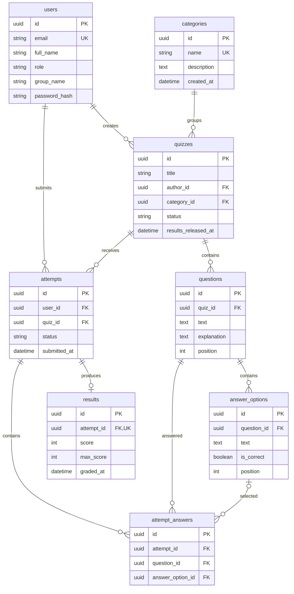

# Модель данных Delul

Актуальна для учебного API модулей 1–6 из api.md. Восемь таблиц, во всех UUID id — первичный ключ. Новая начальная миграция содержит всю эту схему.

## Таблицы

| Таблица | Поля | Ограничения |
|---------|------|-------------|
| users | id, email, full_name, role, group_name, password_hash | email уникален; role: teacher/student/admin; имя и email непустые; группе student нужна непустая group_name |
| categories | id, name, description, created_at | name уникален, created_at задаётся БД |
| quizzes | id, title, author_id, category_id, status, results_released_at | автор и категория обязательны; статусы draft/published/closed; results_released_at допустим только для closed |
| questions | id, quiz_id, text, explanation, position | пара quiz_id/position уникальна |
| answer_options | id, question_id, text, is_correct, position | пара question_id/position уникальна; position от 1; порядок вариантов устойчив |
| attempts | id, user_id, quiz_id, status, submitted_at | in_progress: submitted_at NULL; submitted: время обязательно |
| attempt_answers | id, attempt_id, question_id, answer_option_id | пара attempt_id/question_id уникальна; answer_option_id может быть NULL для пропуска |
| results | id, attempt_id, score, max_score, graded_at | attempt_id уникален; 0 ≤ score ≤ max_score; max_score ≥ 0 |

password_hash — необязательный хеш PBKDF2-SHA256, добавленный по новому заданию о регистрации. Открытых паролей и токенов нет. У демопользователей seed хеш NULL, поэтому их нельзя использовать для проверки login. Это изменение заменяет прежний план входа через Keycloak; Keycloak сейчас не используется.

## Связи

- Один пользователь teacher или admin создаёт много тестов: quizzes.author_id → users.id.
- Одна категория содержит много тестов: quizzes.category_id → categories.id.
- Один тест содержит много вопросов: questions.quiz_id → quizzes.id.
- Один вопрос содержит много вариантов: answer_options.question_id → questions.id.
- Один студент проходит много попыток: attempts.user_id → users.id.
- Один тест имеет много попыток: attempts.quiz_id → quizzes.id.
- Одна попытка содержит много ответов: attempt_answers.attempt_id → attempts.id.
- Один вопрос встречается во многих ответах: attempt_answers.question_id → questions.id.
- Один вариант может быть выбран во многих ответах: attempt_answers.answer_option_id → answer_options.id.
- Одной завершённой попытке соответствует один результат: results.attempt_id → attempts.id, UNIQUE.

Все десять FK имеют ON DELETE RESTRICT. Удаление черновика без попыток сервис выполняет в порядке варианты → вопросы → тест. История попыток не удаляется каскадом.

## ER-диаграмма

## Проверки в сервисах

Проверка роли автора и студента, принадлежности вопросов тесту и вариантов вопросу, полноты ответов, единственного правильного варианта и запрета изменений после публикации выполняется сервисами. Отдельные FK не заменяют эти проверки.

Студенту GET теста не выдаёт is_correct и explanation. Баллы выдаются сразу после сдачи; прежний сценарий отложенного открытия результатов заменён новым заданием. results_released_at сохранён для совместимости; отдельного просмотра разбора ошибок пока нет.

Начальная миграция предназначена для пустой БД; существующую вручную созданную схему нужно предварительно сопоставить. Тесты создают отдельную временную БД и не используют рабочие данные.
