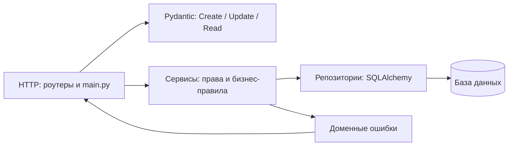

# Слои backend

| Слой | Ответственность | Ограничения |
|------|----------------|-------------|
| schemas | Поля запросов, ограничения Field, необязательные поля Update, from_attributes для Read | В Create нет id, автора и статуса; неизвестные поля запрещены |
| repositories | list/get/create/save/delete, SQL и ORM; unit_of_work управляет commit/rollback | Нет FastAPI, HTTPException, Pydantic и проверок ролей |
| services | Авторство, роли для видимости, состояния теста, публикация, расчёт результата | Нет HTTPException и HTTP-кодов, нет SQL или прямой записи через Session |
| services/errors.py | NotFoundError, ForbiddenError, ConflictError и другие события | Исключения не знают HTTP-кодов |
| routers | Путь, HTTP-метод, зависимости, response_model и код успешного ответа | Вызывают сервисы, не выполняют SQL |
| main.py | Регистрация роутеров и перевод доменных ошибок в HTTP-ответы | Не содержит бизнес-правил |
| core | Настройки, БД, демоличность, Argon2id | Секреты берутся из окружения; пароли и хеши не выдаются клиенту |

PATCH применяет model_dump(exclude_unset=True, exclude_none=True): пропущенные поля и null не затирают данные. Пустой объект запроса запрещён. За права отвечает сервер, а не переданная клиентом роль. Изменения вложенных объектов и сдача выполняются одной транзакцией.
